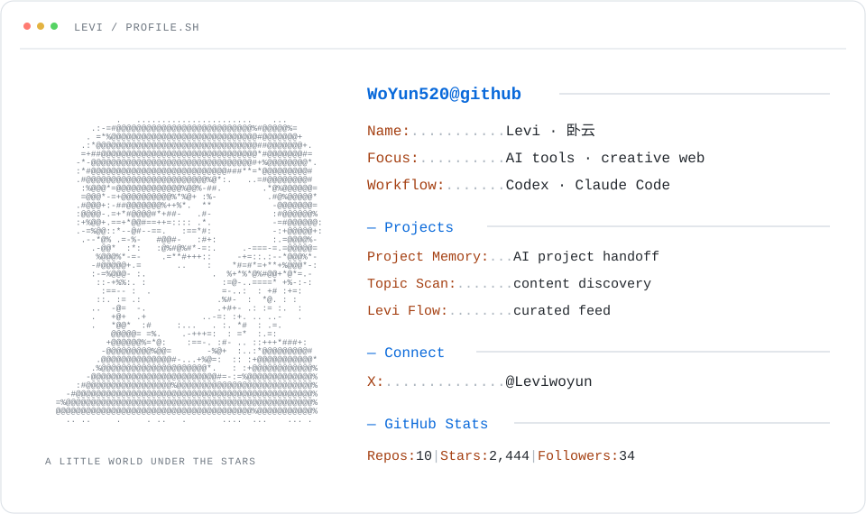

  

  <a href="https://github.com/WoYun520/project-memory">记忆站</a> &nbsp;·&nbsp;
  <a href="https://github.com/WoYun520/viral-topic-scan-skill">爆款选题扫描</a> &nbsp;·&nbsp;
  <a href="https://woyun-feed-preview.hhzovo66.workers.dev/">Levi Flow</a> &nbsp;·&nbsp;
  <a href="https://x.com/Leviwoyun">X / Twitter</a>

从自己遇到的问题开始，把想法慢慢做成作品。

